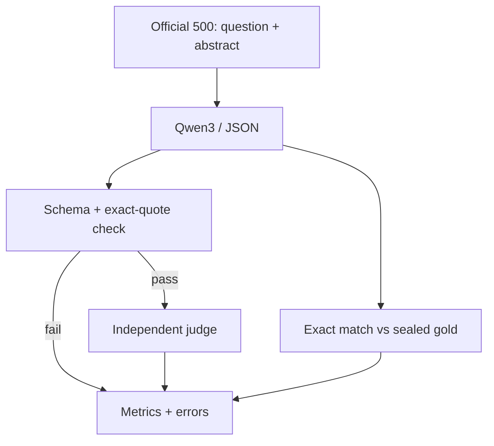

# Small Open LLM Reliability Diagnostic — Medical QA

> Status: `BUILDING` · Start: 2026-10-31 · Appetite: 2 weeks (~12 hours) · Ship/kill: 2026-11-14

## Scope

**GO:** Portfolio diagnostic of local medical QA reliability; learn inference, evaluation, judge calibration. No clinical use.

- **Data:** [HF PubMedQA `pqa_labeled`](https://huggingface.co/datasets/qiaojin/PubMedQA). Loader reads the **official** [GitHub `data/test_ground_truth.json`](https://github.com/pubmedqa/pubmedqa/blob/master/data/test_ground_truth.json) (raw URL: `https://raw.githubusercontent.com/pubmedqa/pubmedqa/master/data/test_ground_truth.json`), joins by PMID, and asserts **500 unique matched IDs**. Other 500 stay unseen until Phase 2. No synthetic data; prompts use only `question` + `context.contexts` (not gold/`long_answer`/hints).
- **Target:** **`qwen3:1.7b` via Ollama** (~1.4 GB; lighter than Llama-3.2-3B for LOQ). Pin digest; thinking off; temperature 0.
- **Output:** Ollama `/api/chat`, JSON Schema in **`format`**, requiring yes/no/maybe label and exact abstract quote:

```json
{"type":"object","properties":{"label":{"type":"string","enum":["yes","no","maybe"]},"evidence":{"type":"string"}},"required":["label","evidence"],"additionalProperties":false}
```

- **Scoring:** Let `norm(s) = " ".join(s.lower().split())`; pre-check `len(norm(evidence)) >= 20 and any(norm(evidence) in norm(c) for c in contexts)`. Fail = **ungrounded**, no judge call; pass → gold-blind semantic judge (supported/unsupported/unclear). Label correctness = deterministic gold match. Report accuracy, macro-F1, invalid/grounded rates and ≥30 human audits.
- **Baselines:** always-yes + majority-class fixed from published priors, **not** test labels (report if identical). No accuracy threshold.
- **Out:** QLoRA, retrieval/embeddings, deployment, UI, larger target models. Supplied-context QA only.

## Prior art

- [PubMedQA paper](https://arxiv.org/abs/1909.06146); [Qwen3 SFT](https://huggingface.co/Emulated-Inc/qwen3-1.7b-pubmedqa-sft-expert); [Llama-3.2 fine-tune](https://huggingface.co/mradermacher/Llama-3.2-3B-pubMedQA-finalDecision-GGUF) (possible contamination).
- [BioGPT-Large](https://huggingface.co/microsoft/BioGPT-Large-PubMedQA): historical 78.2%, **not a comparable ceiling**. Build harness, not QA app.

## Architecture



## Judge options (choose after 20-case pilot)

| Option | Cost and latency |
|---|---|
| **A: Ollama `qwen3:8b`** | $0/token; ~5.2 GB model + RAM/VRAM overhead; CPU fallback slower. Time 20 cases. |
| **B: API `gpt-6-luna`** | Official Standard: $0.10/$0.50 per 1M input/output; ≈$0.07 at 500×(800 in/120 out), excluding retries/reasoning/tax. Network latency; meter usage. |

## Appetite / timebox & roadmap

| When | Deliverable | Exit check |
|---|---|---|
| Days 1–2 | GitHub PMID filter, baselines, 20-case gold-blind pilot | Exactly 500 IDs; quote-check tests |
| Days 3–7 | JSON-schema inference, deterministic checks | 500 predictions; metrics saved |
| Days 8–14 | Judge, ≥30 audit, README, public repo | Errors + latency/cost documented |

## Risks

- **Leakage:** HF labels all 1,000 `train`; select official test PMIDs before analysis; do not inspect reserved records or tune on test errors.
- **Judge:** Normalized 20-character quote ≠ entailment; freeze rubric, blind gold, audit ≥30, report `unclear`.
- **Compute:** Pilot throughput/cost; pin dataset revision, model digests, prompt. No silent extension.

## Backend / frontend

**Backend:** Notebook, Ollama, optional API key via environment; CSV/JSON. Python **3.12**; `requirements.txt` from fresh-venv `pip freeze` (47 pins, including `datasets 5.1.0`, `ollama 0.6.3`, `pandas 3.1.0`, `scikit-learn 1.9.1`). Recheck on Windows. **Frontend:** None; **stretch:** static GitHub Pages results.

## Done criteria

- [ ] Public repo: notebook, setup README, pinned requirements.
- [ ] Results: both baselines/Qwen, accuracy, F1, groundedness, invalids, `n=500`.
- [ ] Judge audit, confusion matrix, three failures, limitations, cost/latency.
- [ ] **Later only:** QLoRA → frozen-harness before/after regression (leakage-safe split).
